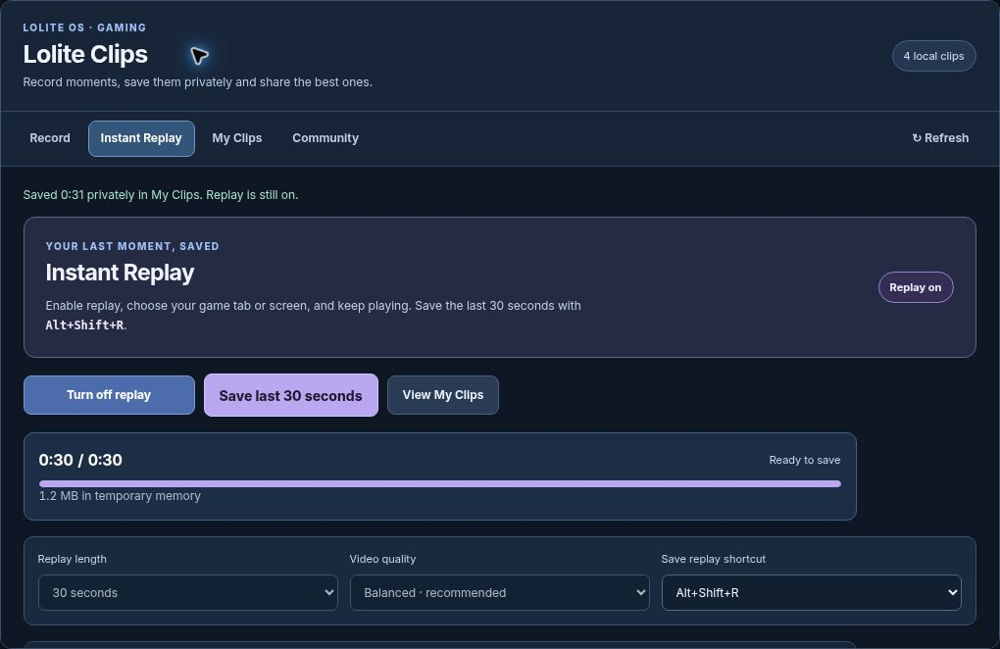

# Lolite Clips — Game Recording and Community Gallery

Lolite Clips is a built-in recording app in the desktop, modern Start menu, Cosmos and App Store. It records an explicitly selected game tab or display using the browser's built-in permission chooser.

## Capture and keybind
1. Open **Lolite Clips** and choose **Record**.
2. Press **Start recording** or the default **Alt+Shift+C** keyboard shortcut while Lolite has keyboard focus.
3. In your browser's screen-sharing prompt, select the game tab/window/screen you want to capture. Capture cannot start without this explicit permission.
4. Press **Alt+Shift+C** again (or Stop & save clip) to stop. You can choose automatic limits of **15, 30, 60 or 90 seconds**, and change the shortcut to **Ctrl+Shift+Y**.
5. A recording indicator is shown while capture is active. Saving a clip automatically stops screen sharing; you can also use **Stop sharing screen** to release the capture source.

**Regular recording** captures from the time you start it. To save footage from before a save shortcut, use **Instant Replay**, described below. Both modes require a supported browser and HTTPS. Audio is included only if the browser supports it and you choose to share audio. Keyboard shortcuts work while Lolite or a same-origin game iframe has focus; cross-origin games and other apps can intercept them, so use the capture controls in those cases.

## Instant Replay (24 November 2026)

1. Open **Lolite Clips → Instant Replay** and choose **30 or 60 seconds** and a video quality.
2. Select **Enable instant replay** and choose the game tab, window or screen in the browser's capture chooser. Replay is off on every new page load and never starts merely because you change a setting.
3. Keep playing. The progress display shows how much recent footage is ready, and a persistent **REPLAY** indicator stays visible even when Clips is closed or minimised.
4. Press **Alt+Shift+R** or **Save last 30/60 seconds** to save a private clip in **My Clips**. **Ctrl+Alt+R** is an alternative shortcut. While the buffer is filling, saving keeps the footage available so far. Saving does not stop capture, so you can save several moments from the same session.
5. Select **Turn off replay**, end screen sharing, or leave/reload Lolite to stop capture and clear the unsaved buffer. Saved clips remain in My Clips.

Replay needs **WebM recording support**; regular recording retains its WebM/MP4 fallback. The replay buffer is held temporarily in memory, with a 48 MiB encoded-footage cap. It keeps a nearby video keyframe to make clips decodable, so a saved clip may be slightly longer than the selected duration. If the byte cap is reached, the available replay can be shorter. Video quality and replay length are locked while replay is running; turn it off to change them. Regular recording and replay cannot run together.

No footage from before replay was enabled is available. There are no global operating-system keyboard hooks: shortcuts have the same Lolite/same-origin focus requirement as regular recording. Capture performance, audio availability and permission dialogs vary by browser and device. Saved replays use the same private local library, downloads and explicit community-sharing flow as other clips. If local storage fails, the saved replay is offered as a download.

## Clips 2.0 recording controls
- **Pause / Resume:** While recording, select **Pause recording** to temporarily stop adding footage. Choose **Resume** to continue within the same file. The time limit counts actual recorded time, not paused time. **Stop & save** also works while paused.
- **Live progress:** The Record page shows elapsed time, seconds left and a progress indicator. The always-visible recording status also says when recording is paused.
- **Video quality:** Choose **Compact** (800 kbps), **Balanced** (1.5 Mbps, default), or **High** (3 Mbps). Higher quality can create larger files and may exceed the 20 MB community-sharing limit; saved local videos have no fixed 20 MB cap beyond browser storage.
- Capture always requires choosing a source in the browser permission prompt. Settings never begin a capture by themselves.

## My Clips: private local library
Recordings are saved as **WebM or MP4** in the browser's **IndexedDB** storage. They are not sent to Lolite servers automatically. **My Clips** lets you watch, rename, favourite, search, sort, download and delete each clip. Favourites and new titles are stored alongside the private local clip and are not shared automatically. Download any clip you want to preserve: clearing browser storage or changing devices may remove local videos. If browser storage fails when a recording ends, the app offers the recording as a download instead.

The library shows the total number of clips, local storage used and favourites. Sort newest/oldest, biggest file, or favourites first. Clip downloads use a readable filename based on your saved title. Actual bitrate/file size depends on the browser and gameplay. Browser storage quotas still apply.

## Share with the community
To share a local clip, choose **Share**, set a title, confirm you have checked it for private details and have permission to share, and then select **Submit for review**. You must be signed into your existing Lolite account. **The recording stays private until you explicitly submit it**, and community clips appear publicly to signed-in Lolite members **only after an authorised admin approves them**.

Uploads are limited to **20 MB** per clip, stored in a private Supabase bucket named `lolite-clips`. Approved clips can be watched in **Community**. Your own unapproved uploads appear in **My submitted clips** under Community; admins see the moderation queue in **Admin review**.

Members can delete their shared clips to unshare them. A local copy stays on the original device unless separately deleted. Video preview links are time-limited and require a member with access to request them.

## Technical notes
- Client-side recorder: `core/clips.js` and `core/clips.css`. Uses user-initiated `getDisplayMedia()`, `MediaRecorder`, and IndexedDB. `core/clip-replay.js` manages replay capture; `core/clip-replay-buffer.js` parses complete WebM blocks, retains a keyframe, and rewrites duration, timestamps and seek cues without re-encoding. Arbitrary MediaRecorder timeslices are not treated as playable files.
- Cloud schema and access policies: `supabase/migrations/20261112070000_lolite_clips.sql`.
- Supabase RLS: only clip owners/admins can read pending or rejected metadata; approved metadata is visible to authenticated Lolite users. Only admins can approve/reject uploads.
- Storage policies: uploads are restricted to the signed-in user's folder; playback is limited to the clip owner, admin, or members watching approved clips. Files must be WebM/MP4.
- No silent or automatic capture, service-role keys, or automatic uploads. Replay continues only within an explicitly enabled, visibly indicated capture session.
- Regression suites: `tests/lolite-clips.test.cjs` and `tests/clip-replay.test.cjs`. Cover repeated saves, bounded retention, keyframe trimming, split WebM elements, cancellation, source ending, shortcut isolation and real VP8/Opus decode/seek through FFmpeg when available.
- Browser fixture: `tests/clips/browser-fixture.html` loads the production modules with a generated canvas and synthetic audio source instead of screen capture, plus isolated test storage. It checks saving and seeking without capturing a real screen or modifying account data.

### Instant Replay browser verification

Chrome verification with the generated canvas and synthetic audio saved an 8.33-second warmup clip, a 30.36-second rolling replay and a 60.46-second rolling replay. Each loaded with a finite duration and decoded after seeking near its end. Repeated saves reused the capture session; stopping and reloading left replay off. The 350-pixel layout kept its controls within the app window. Actual display-selection dialogs and device-specific capture/audio still depend on the browser.

## Clips 3.0 UI and reliability fixes (13 November 2026)

- The app now opens on **Record**, with a clean, responsive layout that fits narrow and maximised windows.
- Clips has its own DOM root (`#loliteClipsRoot`), `lclip-` CSS classes, and data-action attributes. These intentionally do not overlap with Lolite Chat's `#lcRoot` / `lc-` styles or handlers.
- Once the browser screen picker finishes, the **Stop & save clip** button is active. Capture permission is released after saving.
- Videos use stable local object URLs until a clip is deleted or its underlying video changes. Searching, sorting, renaming and favouriting local clips update only the relevant cards to prevent playback jumping back to the beginning.
- Background account refresh no longer rebuilds the private video gallery. Videos without an automatically loaded community preview offer **Load video** to request a fresh, access-controlled link.
- Sharing a clip shows an uploading state and leaves the locally saved copy unchanged. Uploads still require user confirmation and admin approval to appear in the community.
- Regression coverage: `tests/lolite-clips.test.cjs`. Browser-specific capture, audio and mobile resizing should still be tested in the deployed app.
