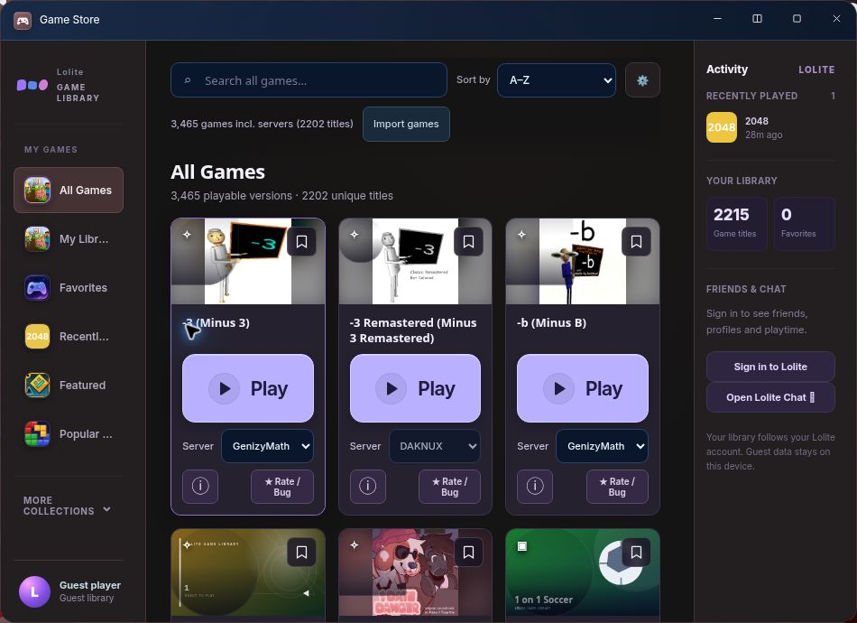

# Cursor reveal highlight

Adds a restrained Windows 10-style surface glow and edge highlight to hovered buttons, desktop icons, navigation controls and selected cards. The light follows the pointer inside the hovered control and fades on exit. Text fields, game frames, media, disabled controls and empty space do not activate it.

The controller uses one delegated pointer listener path and at most one pending animation frame, with no idle rendering loop. It preserves existing pseudo-elements and inline styles, adds no child elements, and disables itself for touch, Reduce Motion and Lite Mode. Scrolling, dragging, keyboard input and lost focus clear the highlight.

Validation: JavaScript syntax check, `git diff --check`, and 30 passing tests across reveal highlighting, shell UI, Cosmos UI and Game Store cleanup. Browser checks confirmed pointer position tracking, fade on exit, working buttons and Lite Mode behavior in the managed preview.

