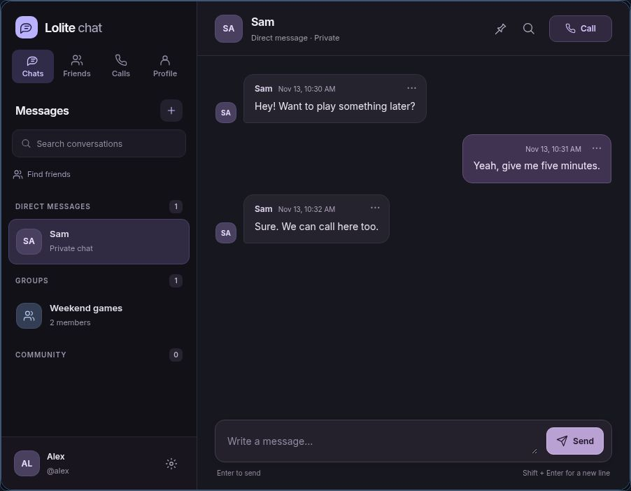
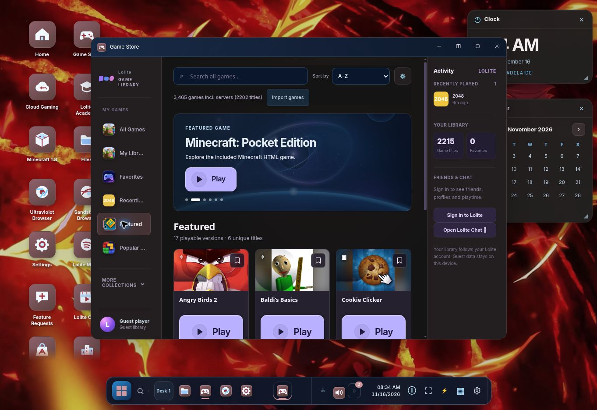

# Lolite interface refresh — 16 November 2026

The interface now uses locally hosted Inter variable fonts, with system fallbacks and monospace retained for terminal/code content. Latin and Latin Extended normal/italic subsets ship with the SIL Open Font License. The initial Latin normal font is preloaded; unused subsets load on demand.

Game cards retain their prominent 76 px Play buttons. Cards and the featured hero now share an SVG play icon, a lavender surface, clearer type, keyboard focus outlines, and reduced-motion support. Launching, server selection, purchases, ratings and reporting use the existing handlers.

Chat now uses a combined navigation/conversation sidebar and a wider conversation pane. Narrow windows use a four-tab bottom bar. Message bubbles, menus, the composer, inbox, friends, profile forms and call surfaces share the refreshed styling. Obsolete Chat rules in the desktop theme stylesheets have been removed. Draft handling, account isolation and call signalling are unchanged.

## Verification

- 19 Chat reliability tests passed.
- 49 existing Game Store, search, account isolation and desktop UI checks passed.
- 35 Cosmos, Crimson and wallpaper-colour integration checks passed (103 unique tests in total).
- The 14 relevant Store/UI checks were rerun after final CSS integration changes and passed.
- JavaScript syntax checks and git diff whitespace checks passed.
- Browser review at 900 px and 350 px Chat window widths, including the Cosmos theme styles: no horizontal content overflow; all four compact navigation tabs remain visible.
- Verified conversation menus, draft preservation through refresh, Friends, Profile, Edit Profile, Calls, and returning to conversations using fictional in-memory accounts.
- Verified Inter computed styles and the 76 px card Play button; verified matching featured Play styling. Launched 2048 successfully through the existing backup-server flow.
- Screenshots below use the local browser preview. Chat contains fictional test accounts and messages, with no production account data.

